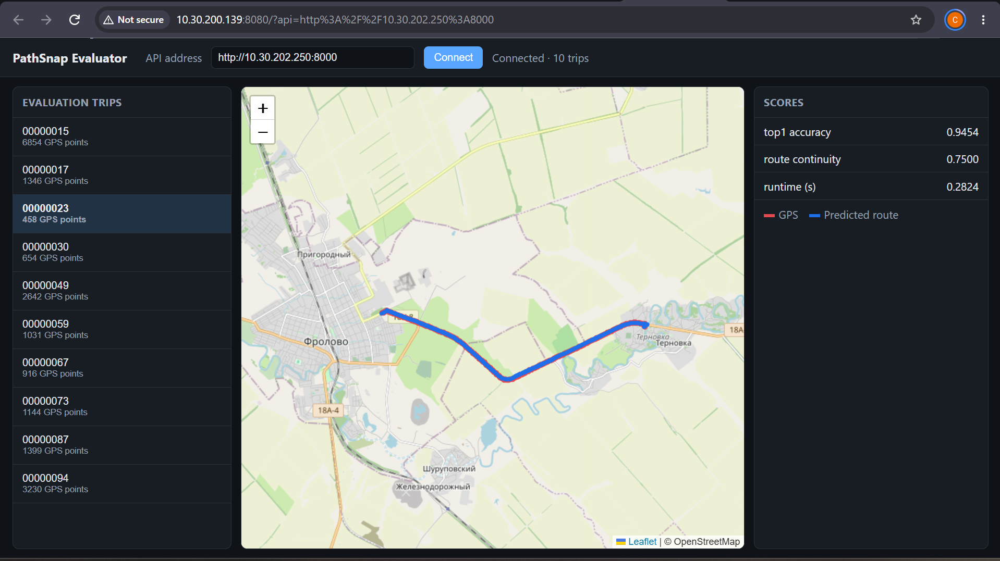
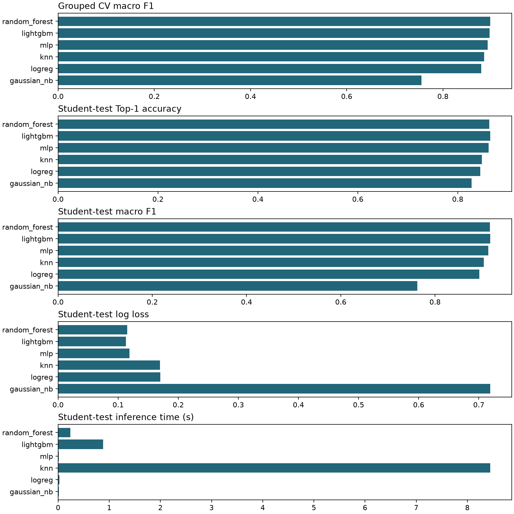
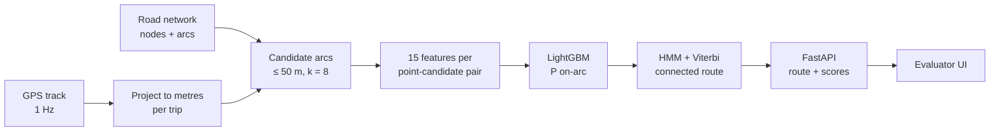
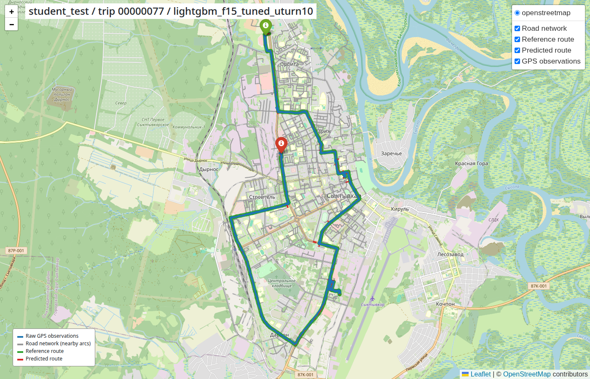
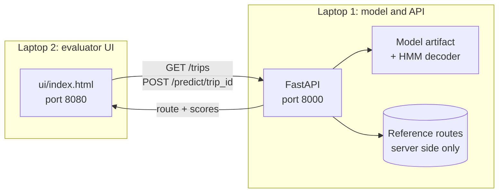

<div align="center">

# PathSnap

**Snap a noisy GPS track to the roads the vehicle actually drove.**

Distributed map-matching and route reconstruction: a LightGBM candidate classifier,<br>
HMM/Viterbi decoding, a FastAPI server on one laptop and an evaluator UI on another.

[](#final-system)
[](#model-comparison)
[](#bayesian-optimisation)
[](tests/)
[](#two-laptop-deployment)
[](requirements.txt)
[](report/PathSnap_Report.md)
[](#team)



<sub>The evaluator UI on laptop 2 showing evaluator trip 00000023, predicted and scored by the API on laptop 1 (submitted version).</sub>

[Results](#results) · [Decoder fix](#after-submission-decoder-fix) · [How it works](#how-it-works) · [Deployment](#two-laptop-deployment) · [Reproduce](#reproduce-the-results) · [Layout](#repository-layout) · [Report](report/PathSnap_Report.md) · [Team](#team)

</div>

---

PathSnap takes a noisy 1 Hz GPS track and the road network around it, and works out which road segment
(arc) the vehicle was on at every GPS point. A LightGBM classifier scores the nearby candidate arcs for each
point, and an HMM decoded with Viterbi turns those scores into a route that follows connected roads. A
FastAPI server on one laptop runs the model and scores it against reference routes it keeps to itself; an
evaluator UI on a second laptop picks a trip and draws the result.

The full technical report, with every table and figure, is in
[report/PathSnap_Report.md](report/PathSnap_Report.md).

## Results

All numbers below are read from files in `results/`, which the scripts in this repository write.

### Final system

The current model (`artifacts/lightgbm_f15_tuned_backtol15.joblib`) run end to end through the API, with
every trip scored on the server. The submitted version is shown alongside it; the only difference between
the two is one decoder rule, described under [After submission](#after-submission-decoder-fix).

| | Student test, current | Evaluator, current | Student test, submitted | Evaluator, submitted |
|---|---|---|---|---|
| **Top-1 accuracy** (share of GPS points on the right arc) | **0.9428** | **0.9493** | 0.9076 | 0.9244 |
| Route continuity (mean over trips) | 0.8911 | 0.8453 | 0.8103 | 0.7680 |
| GPS points scored | 19,160 | 19,674 | 19,160 | 19,674 |
| Mean inference time per trip | 0.92 s | 0.93 s | 0.83 s | 0.89 s |

Sources: `results/e2e/api_<partition>_lightgbm_f15_tuned_backtol15.json` (commit `fad7d45`) and
`results/e2e/api_<partition>_lightgbm_f15_tuned_uturn10.json` (commit `c96bedb`). The evaluator trips were never
used for training or for any choice; each version was run on them once, after its settings were fixed.

### After submission: decoder fix

The submitted decoder treated a GPS point that appears to move backwards along the same arc as a real
backward move unless the step was under 5% of the arc's length. On a 40 m arc that is 2 m, less than normal
GPS jitter, so the decoder charged it as a drive to the end of the arc and back. Small β values then punished the
right arc, the β search drifted up to 100, and the distance check stopped doing much. The fix allows up to
15 m of apparent backward movement on the same arc, whatever its length (`back_tol_m` in `pathsnap/hmm.py`).

The new setting was chosen the same way as the old one: a grid over β {2, 5, 10, 20, 50, 100}, emission
weight {0.5, 1}, U-turn penalty {0, 10} and the old rule against the new one, scored on the training trips'
out-of-fold predictions only (`results/hmm/hmm_vs_classifier_f15_backtol.json`, commit `3e34048`). The 15 m
rule beat the 5% rule in all 24 matched settings. Best out-of-fold Top-1 went from 0.7855 (5% rule, β = 100,
w = 1, U-turn 10) to 0.8257 (15 m rule, β = 5, w = 1, U-turn 10). The classifier is unchanged. The technical
report in `report/` describes the submitted version.

### What the HMM adds

Same 15-feature LightGBM, scored per GPS point on the student-test trips
(`results/hmm/hmm_vs_classifier_f15_backtol.json`, current decoder):

| | Classifier only | Classifier + HMM/Viterbi |
|---|---|---|
| Top-1 accuracy | 0.8667 | **0.9407** |
| Route continuity | 0.7788 | **0.8899** |
| Route arc F1 | 0.8581 | **0.9327** |

With the submitted decoder the same comparison gave 0.9059 Top-1 (`results/hmm/hmm_vs_classifier_f15.json`).

### Model comparison

Six model families, same 12 features, same 5-fold `GroupKFold` split by trip on the 80 training trips, seed
42. Top-1 and continuity are classifier only, on the student-test trips
(`results/models/comparison.csv`, `results/models/inference_time.json`).

| Model | Family | CV macro F1 | Test Top-1 | Test macro F1 | Test log loss | Inference (s) |
|---|---|---|---|---|---|---|
| Logistic Regression | Linear | 0.8799 ± 0.0289 | 0.8453 | 0.8939 | 0.1703 | 0.015 |
| Gaussian Naive Bayes | Probabilistic | 0.7555 ± 0.0198 | 0.8275 | 0.7623 | 0.7191 | 0.007 |
| K-Nearest Neighbours | Instance-based | 0.8859 ± 0.0272 | 0.8480 | 0.9037 | 0.1697 | 12.162 |
| Random Forest | Bagging | 0.8984 ± 0.0266 | 0.8634 | 0.9162 | 0.1153 | 0.502 |
| **LightGBM** (chosen) | Boosting | 0.8969 ± 0.0276 | **0.8651** | **0.9172** | **0.1129** | 0.369 |
| MLP | Neural network | 0.8930 ± 0.0277 | 0.8620 | 0.9133 | 0.1187 | 0.045 |

Random Forest, LightGBM and the MLP are within 0.006 CV macro F1 of each other, inside the fold-to-fold
spread. LightGBM was chosen for the best student-test Top-1 and macro F1, the lowest log loss (the HMM uses
the probabilities directly) and a smaller train-test gap than Random Forest.



### Bayesian optimisation

Optuna TPE, 32 trials, objective = mean CV macro F1 over the same grouped folds
(`results/hpo/trials_lightgbm_f15.csv`):

| LightGBM, 15 features | CV macro F1 | Test Top-1 | Test macro F1 | Inference (s) |
|---|---|---|---|---|
| Untuned | 0.8980 ± 0.0279 | 0.8667 | 0.9178 | 0.358 |
| Tuned | 0.9009 ± 0.0261 | 0.8658 | 0.9178 | 1.983 |

Tuning gave no measurable gain; the difference is well inside the fold-to-fold spread. We report it as a
negative result.

## How it works



1. **Projection.** Trips are spread across several continents, so each one is projected to metres with an
   azimuthal equidistant projection centred on its own GPS points.
2. **Labels.** The reference route has no timestamps. Each GPS point is matched to a position on the route
   by dynamic programming, so positions never go backwards in time.
3. **Candidates.** Up to 8 arcs within 50 m of each point, found with a spatial index. The radius and k
   come from a sweep on the training trips.
4. **Features.** Distance and rank, position along the arc, heading agreement, speed and turn rate, and how
   close the neighbouring GPS points are to the same arc.
5. **Classifier.** LightGBM gives the probability that each candidate is the right arc.
6. **HMM and Viterbi.** Hidden states are the candidates. Emissions come from the classifier; transitions
   penalise the gap between road-network distance and straight-line distance, plus a U-turn penalty.
   Up to 15 m of apparent backward movement on the same arc counts as GPS jitter. Decoding restarts after
   gaps over 60 s. Decoder settings were chosen on training trips only.



## Two-laptop deployment



Reference routes stay on laptop 1. The UI receives only the predicted route, the GPS points and the scores.

### Install

Python 3.11 or newer (developed and tested on 3.13). Put the dataset in `data/raw/Student folder/` with `train/` and `student_test/`
inside (git ignores `data/`).

```
python -m venv .venv
.venv\Scripts\activate          # Windows;  source .venv/bin/activate on Linux or macOS
pip install -r requirements.txt
python -m pytest                 # 26 tests
```

### Laptop 1: API

Point the API to the model artifact, the evaluator's trip folder and the address the UI will be opened at.

Windows (PowerShell):

```powershell
$env:PATHSNAP_MODEL_ARTIFACT = (Resolve-Path artifacts/lightgbm_f15_tuned_backtol15.joblib).Path
$env:PATHSNAP_EVALUATION_DIR = 'C:\path\to\reserved-trips'
$env:PATHSNAP_UI_ORIGIN = 'http://<laptop-2-ip>:8080'
python -m uvicorn api.main:app --host 0.0.0.0 --port 8000
```

Linux or macOS:

```bash
export PATHSNAP_MODEL_ARTIFACT="$PWD/artifacts/lightgbm_f15_tuned_backtol15.joblib"
export PATHSNAP_EVALUATION_DIR=/path/to/reserved-trips
export PATHSNAP_UI_ORIGIN=http://<laptop-2-ip>:8080
python -m uvicorn api.main:app --host 0.0.0.0 --port 8000
```

On Windows, open the port once as administrator:
`netsh advfirewall firewall add rule name="PathSnap API" dir=in action=allow protocol=TCP localport=8000`.
Every request is logged in this terminal. For development, use `data/raw/Student folder/student_test` as
the trip folder.

### Laptop 2: UI

```
python -m http.server 8080 --bind 0.0.0.0 --directory ui
```

Open `http://<laptop-2-ip>:8080` (the same address as `PATHSNAP_UI_ORIGIN`), type
`http://<laptop-1-ip>:8000` in the API address box and press Connect. The page needs internet access for the
map tiles. The API contract is in [ui/README.md](ui/README.md).

### If the UI cannot connect

1. From laptop 2, open `http://<laptop-1-ip>:8000/trips` in a browser. A JSON list means the network works;
   a timeout means a firewall or the two laptops are on different networks.
2. If that works but the UI still says "Cannot reach the API", the page address does not match
   `PATHSNAP_UI_ORIGIN`. Open the UI at exactly that address, including the port.

## Reproduce the results

Every number and figure in the report is read from `results/` by `report/build_report.py`. These commands
rewrite those files. They use the 15-feature set in `pathsnap/features.py`; the 12-feature model comparison
was produced at commit `78f6c4e`.

| Report section | Command | Output |
|---|---|---|
| 2. EDA | `python scripts/eda.py` and `python -m scripts.road_network_plot` | `results/eda/` |
| 2. Candidates and features | `python -m scripts.build_features` and `python -m scripts.candidate_sweep` | `data/interim/`, `results/candidates/` |
| 3. Models | `python -m scripts.train_models --model <name>` for each model, then `python -m scripts.compare_models` | `results/models/` |
| 3.3 Diagnostics | `python -m scripts.model_diagnostics` and `python -m scripts.time_inference` | `results/models/diagnostics/`, `results/models/inference_time.json` |
| 4.2 Untuned LightGBM, 15 features | `python -m scripts.train_models --model lightgbm --name lightgbm_15feat` | `results/models/lightgbm_15feat.json` |
| 4. Bayesian optimisation | `python scripts/tune.py search --study lightgbm_f15 --worker <i>` (one or more workers), then `python scripts/tune.py finalize --study lightgbm_f15 --name lightgbm_f15_tuned` | `results/hpo/`, `results/models/lightgbm_f15_tuned.json` |
| 5. HMM | `python -m scripts.hmm_eval --betas 50 100 200 --ws 1 --uturns 0 2 5 10 --tag _f15` (add `--exclude-train-trips 00000054 --tag _f15_excl54` for the trip-54 check) | `results/hmm/` |
| Decoder fix (after submission) | `python -m scripts.hmm_eval --betas 2 5 10 20 50 100 --ws 0.5 1 --uturns 0 10 --back-tols rel 15 --tag _f15_backtol` | `results/hmm/hmm_vs_classifier_f15_backtol.json` |
| 5. Error analysis | `python scripts/error_analysis.py results/hmm/student_test_predictions_f15.json` | `results/hmm/error_analysis_f15.json` |
| 6. Folium maps | `python scripts/make_prediction_maps.py artifacts/lightgbm_f15_tuned_uturn10.joblib student_test 00000007 00000009 00000077` | `results/maps/` |
| 7. End to end | `python -m scripts.api_e2e artifacts/<artifact>.joblib "data/raw/Student folder/student_test"` (or the evaluator trip folder) | `results/e2e/` |
| Model artifact, current | `python -m scripts.export_model --jobs 8 --params-json results/hpo/best_params_lightgbm_f15.json --beta-m 5 --uturn-penalty 10 --back-tol-m 15 --output artifacts/lightgbm_f15_tuned_backtol15.joblib` | `artifacts/` |
| Model artifact, submitted | `python -m scripts.export_model --jobs 8 --params-json results/hpo/best_params_lightgbm_f15.json --output artifacts/lightgbm_f15_tuned_uturn10.joblib` | `artifacts/` |
| Report | `python report/build_report.py`, then `python report/build_pdf.py` (needs Chrome or Chromium) | `report/PathSnap_Report.md`, `report/PathSnap_Report.pdf` |

Model names for `train_models`: `logreg`, `gaussian_nb`, `knn`, `random_forest`, `lightgbm`, `mlp`. All
settings (seed, paths, candidate radius, folds) are in `configs/default.yaml`; the search space is in
`configs/search_space.yaml`.

## Repository layout

| Path | Contents |
|---|---|
| `pathsnap/` | Library: loading, projection, labels, candidates, features, metrics, HMM, prediction, maps |
| `scripts/` | One command per pipeline step (see the table above) |
| `api/` | FastAPI server (`main.py`) and server-side scoring (`evaluate.py`) |
| `ui/` | Evaluator page; `ui/mock_api.py` stands in for the API when testing the UI alone |
| `artifacts/` | The current and the submitted exported models |
| `configs/` | Run settings and the Bayesian search space |
| `results/` | Every CSV, JSON, log and plot the scripts write |
| `report/` | Report builder, figures and the generated report |
| `docs/` | Data-quality record and the phase reports |
| `tests/` | Unit and API tests |

## Team

| Member | Main areas |
|---|---|
| Vivian Sobers E | Labels, candidates, core features, final model, Bayesian optimisation, HMM/Viterbi, server-side evaluation, integration |
| Chirag Basanth Bellavi | Metrics, cross-validation harness, three of the six models, comparison plots, FastAPI backend |
| Harsimran Kaur | EDA, data-quality record, Folium maps, report figures |
| Chiranthan B S Raj | Evaluator UI, run instructions, UI and API screenshots |
