

PES UNIVERSITY

Department of Computer Science and Engineering

UE24CS352A: Machine Learning

ML Hackathon, Technical Report

<h1 style="font-size:30pt;margin:22mm 0 6pt">PathSnap</h1>

Distributed Map-Matching and Route Reconstruction

Team 35 &middot; Section C

<table align="center" style="width:auto;margin:0 auto;font-size:11pt">
<tr><th style="padding:5pt 14pt">Name</th><th style="padding:5pt 14pt">SRN</th></tr>
<tr><td style="padding:5pt 14pt">Chirag Basanth Bellavi</td><td style="padding:5pt 14pt">PES1UG24CS133</td></tr>
<tr><td style="padding:5pt 14pt">Chiranthan B S Raj</td><td style="padding:5pt 14pt">PES1UG24CS134</td></tr>
<tr><td style="padding:5pt 14pt">Harsimran Kaur</td><td style="padding:5pt 14pt">PES1UG24CS187</td></tr>
<tr><td style="padding:5pt 14pt">Vivian Sobers E</td><td style="padding:5pt 14pt">PES1UG24CS901</td></tr>
</table>

18 November 2026

github.com/VivianSobers/pathsnap

## Team and contributions

| Name | SRN | Main areas |
|---|---|---|
| Chirag Basanth Bellavi | PES1UG24CS133 | Metrics, cross-validation harness, three of the six models, comparison plots, FastAPI backend |
| Chiranthan B S Raj | PES1UG24CS134 | Evaluator UI, run instructions, UI and API screenshots |
| Harsimran Kaur | PES1UG24CS187 | EDA script, data-quality record, Folium maps, report figures |
| Vivian Sobers E | PES1UG24CS901 | Labels, candidates, core features, final model, Bayesian optimisation, HMM/Viterbi, server-side evaluation, integration |

## Summary

- **Task.** Match each point of a noisy 1 Hz GPS track to the road arc it lies on, and serve the result
  from an API on one laptop to an evaluator UI on another.
- **Method.** Up to 8 candidate arcs within 50 m per point, 15 features per (point, candidate) pair, six
  model families compared with 5-fold grouped cross-validation, LightGBM chosen, then an HMM decoded with
  Viterbi so that the route follows connected roads.
- **Result.** The HMM raised student-test Top-1 from 0.8651
  to 0.8877 over the classifier alone (12 features, no U-turn
  penalty). With 15 features, the tuned model and the U-turn penalty, the final pipeline through the API scores a pooled Top-1 of 0.9076 on the 10 student-test trips.
- **Final evaluator result.** On the 10 evaluator trips, scored once with the committed final model, pooled
  Top-1 is 0.9244 and mean route continuity 0.7680 (section 7.5).
- **Negative results, reported as such.** Bayesian optimisation and dropping the noisiest training trip gave
  no measurable gain.

Every number in this report is generated from a file in `results/` by `report/build_report.py`. Partitions
used: **train** = 80 training trips (fitting and grouped cross-validation), **student test** = 10
student-testing trips (development-stage comparison). The 10 evaluator trips were not used for training
or for any choice; they were scored once, with the final committed model, for section 7.5.

## Contents

1. Problem and approach
2. Dataset understanding and EDA
3. Model experimentation and comparison
4. Bayesian hyperparameter optimisation (LightGBM)
5. HMM and Viterbi route reconstruction
6. Geographical visualisation (Folium)
7. API, UI and deployment
8. Conclusions and limitations

## 1. Problem and approach

Each trip has a noisy 1 Hz GPS track, its own road network (nodes and directed arcs) and a reference route
(the arc ids driven, in order). For every GPS observation we predict the road arc it lies on. The pipeline:
(1) project each trip to metres; (2) label each observation with a reference arc by aligning the route to
the track; (3) take up to 8 candidate arcs within 50 m of each observation; (4) score every
(observation, candidate) pair with a classifier; (5) decode the whole trip with an HMM and Viterbi so the
route follows connected roads; (6) serve the result through a FastAPI backend to an evaluator UI.

## 2. Dataset understanding and EDA

### 2.1 How the data was preprocessed

- **Loading and validation** (`pathsnap/io.py`). Each trip's `.track` (lon, lat, t), `.nodes` (lon, lat),
  `.arcs` (from_node, to_node) and `.route` (arc ids) are read; arcs pointing at missing nodes and route ids
  pointing at missing arcs are rejected. All 90 trips pass.
- **Projection** (`pathsnap/geo.py`). The trips lie on several continents, so no single UTM zone fits.
  Each trip is projected with an azimuthal equidistant projection centred on its GPS centroid; tests show
  planar distances match geodesic distances within 0.1% at four locations worldwide.
- **Labels** (`pathsnap/labels.py`). The route has no timestamps, so each observation is aligned to a
  route position by dynamic programming: positions never go backwards and the summed point-to-arc distance
  is minimal. This handles routes that revisit a road.
- **Candidates** (`pathsnap/candidates.py`). Arcs within 50 m, at most 8 per observation, found with a
  shapely STRtree. Radius and k were chosen with a sweep on the training trips (section 2.4).
- **Gaps.** Time gaps over 60 s split the HMM decoding; real time differences are used in every feature.

### 2.2 Inventory (train and student test)

From `results/eda/inventory_by_partition.csv`:

| Partition | Trips | GPS points | Points per trip (min / median / max) | Nodes per trip (median / max) | Arcs per trip (median / max) | Route length in arcs (median / max) |
|---|---|---|---|---|---|---|
| Train | 80 | 208,417 | 361 / 1,529 / 19,313 | 9,608 / 155,003 | 19,526 / 307,392 | 280 / 2,266 |
| Student test | 10 | 19,160 | 262 / 1,420 / 3,958 | 6,596 / 26,635 | 13,145 / 56,027 | 250 / 1,323 |

### 2.3 Missing values and data quality (train and student test)

From `results/eda/trip_summary.csv` and `results/eda/sampling_intervals.csv`:

| Check | Train | Student test |
|---|---|---|
| Missing (NaN) GPS values | 0 | 0 |
| Out-of-range coordinates | 0 | 0 |
| Non-increasing timestamps | 0 | 0 |
| Isolated road nodes | 0 | 0 |
| Route ids out of range | 0 | 0 |
| Steps exactly 1 s apart | 96.50% | 98.62% |
| Steps over 30 s | 0.064% | 0.010% |
| Longest gap | 153,064 s | 210 s |
| Route breaks (consecutive arcs not connected) | 13 | 1 |
| Position jumps over 100 m | 227 | 0 |

There are no missing values, so no imputation was needed. The problems are of other kinds: irregular
sampling with some very long gaps (one training trip has a gap of over 42 hours), position jumps, reference
routes with breaks, and road networks split into many weakly connected components. Decisions for each are in
`docs/data_quality.md`.

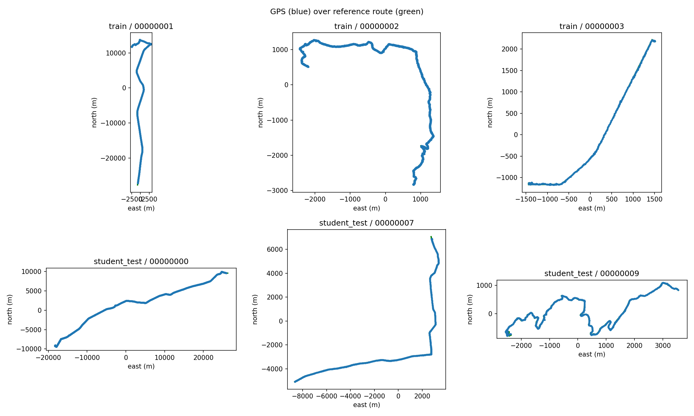

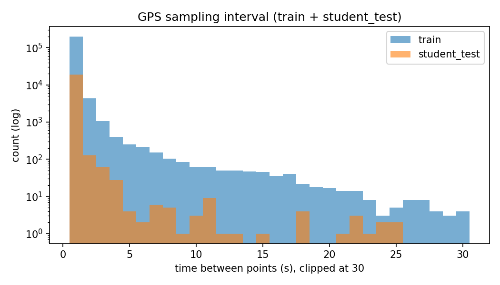

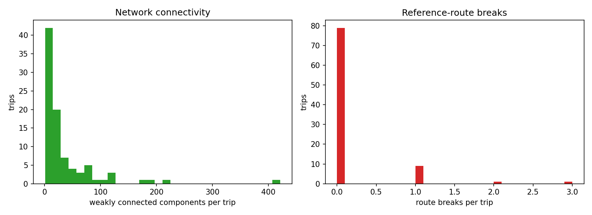

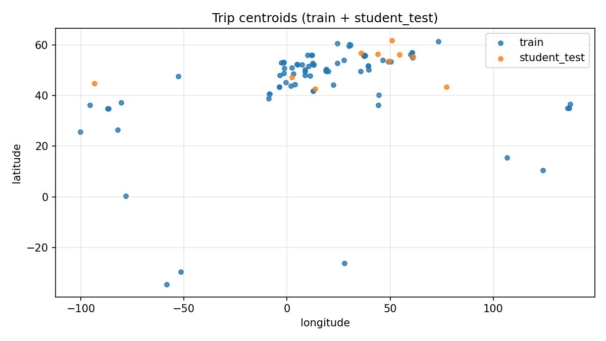

### 2.4 Patterns observed and the features chosen

- **Most points are close to the right arc, but not always the nearest one.** Parallel roads, two-way
  roads stored as two arcs with the same geometry, and GPS noise make the nearest arc wrong for many
  points, so distance alone is not enough.
- **Coverage.** With 50 m and k = 8, 0.42% of student-test observations and
  11.92% of training observations have no correct arc among their candidates.
  Without trip `00000054`, whose points mostly lie far from its network, the training figure is
  3.87% (`results/candidates/sweep.csv`). Larger radii lower it only slowly while
  growing the candidate set quickly.
- **Direction matters**: heading separates the two directions of a two-way road and rejects cross streets.

Fifteen features per (observation, candidate) pair (`pathsnap/features.py`):

| Group | Features | Why |
|---|---|---|
| Distance | `dist`, `rank`, `dist_minus_min`, `n_cand` | Closeness, and how ambiguous the point is |
| Position on arc | `t_along`, `arc_len` | Points projecting onto an arc's end are often on the next arc |
| Direction | `cos_heading`, `abs_cos_heading` | Separates two-way directions; rejects cross streets |
| Motion | `speed`, `dt_prev`, `turn_rate_rad_s` | Speed, gaps and turning change how far the point can be from the road |
| Neighbours | `dist_prev_pt`, `dist_next_pt`, `previous_candidate_m`, `next_candidate_m` | A true arc stays close across consecutive points |

The first 12 were used for the model comparison (section 3). The last three were added afterwards and kept
because they improved every metric slightly (section 4.2).

### 2.5 Folium map

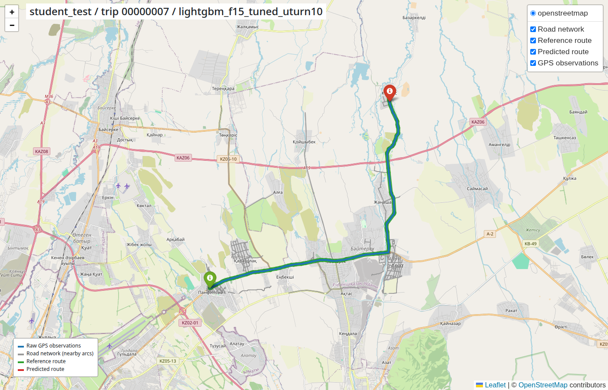

Student-test trip `00000007`: raw GPS points (blue), nearby road network (grey), reference route (green) and
predicted route (red), with layer control. Interactive maps: `results/maps/`.

## 3. Model experimentation and comparison

Six models from six families were trained with identical features (the first 12), identical
`GroupKFold` folds (5 folds grouped by trip on the 80 training trips) and seed 42, then refit on all 80
training trips and scored on the 10 student-test trips. Scaling sits inside each pipeline, so it is fit on
training folds only. Each model is a binary classifier of candidate pairs ("is this the reference arc?");
the highest-probability candidate per observation is its classifier-only prediction.

### 3.1 Overall comparison

From `results/models/comparison.csv` and `results/models/inference_time.json`. Top-1 and route continuity
are classifier-only (no HMM), on the student-test trips. Inference time is predicting all
113,639 student-test candidate pairs, median of 5 runs, all models on the same machine.

| Model | Algorithm family | Key configuration | CV macro F1 | Top-1 accuracy | Route continuity | Student-test macro F1 | Log loss | Inference time (s) |
|---|---|---|---|---|---|---|---|---|
| Logistic Regression | Linear | StandardScaler; L2, C = 1.0; lbfgs, max_iter 1000 | 0.8799 ± 0.0289 | 0.8453 | 0.7387 | 0.8939 | 0.1703 | 0.015 |
| Gaussian Naive Bayes | Probabilistic | Gaussian likelihoods, default variance smoothing | 0.7555 ± 0.0198 | 0.8275 | 0.7296 | 0.7623 | 0.7191 | 0.007 |
| K-Nearest Neighbours | Instance-based | StandardScaler; k = 25; distance weighted; Euclidean; fit on 150k-row seeded sample | 0.8859 ± 0.0272 | 0.8480 | 0.7590 | 0.9037 | 0.1697 | 12.162 |
| Random Forest | Bagging ensemble | 150 trees; min_samples_leaf 5; sqrt of features tried per split | 0.8984 ± 0.0266 | 0.8634 | 0.7737 | 0.9162 | 0.1153 | 0.502 |
| LightGBM | Boosting | 400 boosting rounds; learning rate 0.05; 63 leaves | 0.8969 ± 0.0276 | 0.8651 | 0.7760 | 0.9172 | 0.1129 | 0.369 |
| Multi-layer Perceptron | Neural network | StandardScaler; hidden (64, 32), ReLU; Adam; early stopping | 0.8930 ± 0.0277 | 0.8620 | 0.7785 | 0.9133 | 0.1187 | 0.045 |

**Primary metric.** We select on student-test Top-1 and log loss together with CV macro F1. Top-1 is the
guidelines' observation-level target; log loss matters because the HMM uses the probabilities directly.

**Selection: LightGBM.** Random Forest, LightGBM and MLP are within 0.006 CV macro F1 of each other while
the fold-to-fold standard deviation is about 0.027, so CV alone cannot separate them. LightGBM has the best
student-test macro F1 (0.9172) and Top-1 (0.8651),
the lowest student-test log loss (0.1129), ties Random Forest on CV log loss and overfits less than
Random Forest (section 3.2).

### 3.2 Questions for every model

### 3.2.1 Logistic Regression (Linear)

**A1. Why suitable.** A linear model on well-scaled geometric features is the simplest sensible baseline: whether a candidate is the reference arc depends mostly on how close it is and whether its direction matches the vehicle, both close to linear in our features. It gives calibrated probabilities directly, which the HMM needs.

**A2. Strengths and limitations.** Fast to train and predict, stable across folds and directly interpretable through its coefficients. It cannot model interactions (for example, that a small distance matters less when several candidates are equally close) unless we build them as features.

**B5. Hyperparameters and initial values.** C = 1.0 (inverse L2 strength), lbfgs solver, max_iter 1000; inputs standardised inside the pipeline.

**B6. Loss or objective.** Binary cross-entropy (log loss) with an L2 penalty.

**C7. Student-test performance.** Candidate-level accuracy 0.9412, macro precision 0.8970, macro recall 0.8908; route continuity of its classifier-only predictions 0.7387. Confusion matrix at threshold 0.5 (rows reference, columns predicted): 91,405 true negatives, 3,155 false positives, 3,532 false negatives, 15,547 true positives (`results/models/diagnostics/confusion_logreg.png`).

**C8. Top-1, macro F1 and log loss (student test).** Top-1 0.8453, macro F1 0.8939, log loss 0.1703.

**C9. Overfitting or underfitting.** Underfitting rather than overfitting: macro F1 is 0.8824 on the training trips and 0.8939 on the student-test trips (higher on test), and CV macro F1 is 0.8799, below every tree model. The model's linear form is the limit.

### 3.2.2 Gaussian Naive Bayes (Probabilistic)

**A1. Why suitable.** A probabilistic baseline that models each feature per class with a Gaussian and combines them with Bayes' rule. It tests how far the features carry signal independently of each other.

**A2. Strengths and limitations.** Trains in about a second and needs no tuning. Its independence assumption is badly violated here: distance, rank and distance-to-nearest-candidate are strongly correlated, so their evidence is counted several times and the probabilities are overconfident.

**B5. Hyperparameters and initial values.** Defaults (var_smoothing 1e-9); no scaling needed.

**B6. Loss or objective.** No iterative loss: class priors and per-feature Gaussian means and variances are estimated by maximum likelihood.

**C7. Student-test performance.** Candidate-level accuracy 0.8261, macro precision 0.7351, macro recall 0.8624; route continuity of its classifier-only predictions 0.7296. Confusion matrix at threshold 0.5 (rows reference, columns predicted): 76,383 true negatives, 18,177 false positives, 1,582 false negatives, 17,497 true positives (`results/models/diagnostics/confusion_gaussian_nb.png`).

**C8. Top-1, macro F1 and log loss (student test).** Top-1 0.8275, macro F1 0.7623, log loss 0.7191.

**C9. Overfitting or underfitting.** Underfitting: macro F1 0.7561 on training and 0.7623 on test, the lowest of all models, with log loss around 0.70. The confusion matrix shows why: it flags 18,177 non-reference candidates as reference arcs (precision 0.4905), so it over-predicts the positive class.

### 3.2.3 K-Nearest Neighbours (Instance-based)

**A1. Why suitable.** An instance-based model: a candidate is labelled like the most similar candidates seen in training. Similar geometric situations (distance, heading match, position on the arc) should have similar answers, so local similarity is a natural fit.

**A2. Strengths and limitations.** No training cost beyond storing data, and flexible decision boundaries. Prediction is slow because every query searches the stored set, and distances depend on feature scaling, so all features are standardised. Probabilities are coarse (fractions of 25 neighbours) and its log loss is high.

**B5. Hyperparameters and initial values.** k = 25, distance weighting, Euclidean distance (Minkowski p = 2) on standardised features; fit on a seeded 150,000-row sample of each training fold to keep prediction time practical.

**B6. Loss or objective.** No loss is optimised; the prediction is a distance-weighted vote of the 25 nearest training pairs.

**C7. Student-test performance.** Candidate-level accuracy 0.9471, macro precision 0.9108, macro recall 0.8969; route continuity of its classifier-only predictions 0.7590. Confusion matrix at threshold 0.5 (rows reference, columns predicted): 92,086 true negatives, 2,474 false positives, 3,397 false negatives, 15,682 true positives (`results/models/diagnostics/confusion_knn.png`).

**C8. Top-1, macro F1 and log loss (student test).** Top-1 0.8480, macro F1 0.9037, log loss 0.1697.

**C9. Overfitting or underfitting.** Slight overfitting: macro F1 0.9109 on training and 0.9037 on test. With distance weighting, a training pair that is in the stored 150,000-row sample is its own nearest neighbour, which inflates the training score. The confusion matrix in this report refits on a different 150,000-row sample, so its accuracy (0.9483) differs slightly from the recorded 0.9471.

### 3.2.4 Random Forest (Bagging ensemble)

**A1. Why suitable.** An ensemble of decision trees captures non-linear rules and interactions between features (for example distance combined with heading mismatch) without scaling, and bagging makes it stable.

**A2. Strengths and limitations.** Strong accuracy with little tuning and robust to feature scale. It fits the training trips more closely than any other model and is slower to train; its probabilities are averaged votes and slightly less well calibrated than boosting's.

**B5. Hyperparameters and initial values.** 150 trees, min_samples_leaf 5, default sqrt features per split, bootstrap sampling, seed 42.

**B6. Loss or objective.** Each tree is grown by minimising Gini impurity; the forest averages the trees' class probabilities.

**C7. Student-test performance.** Candidate-level accuracy 0.9540, macro precision 0.9238, macro recall 0.9090; route continuity of its classifier-only predictions 0.7737. Confusion matrix at threshold 0.5 (rows reference, columns predicted): 92,363 true negatives, 2,197 false positives, 3,035 false negatives, 16,044 true positives (`results/models/diagnostics/confusion_random_forest.png`).

**C8. Top-1, macro F1 and log loss (student test).** Top-1 0.8634, macro F1 0.9162, log loss 0.1153.

**C9. Overfitting or underfitting.** Mild overfitting, the largest of the six: macro F1 0.9551 on training against 0.9162 on test (accuracy 0.9752 against 0.9540). It has the best CV macro F1 (0.8984) but does no better than LightGBM on the student-test trips.

### 3.2.5 LightGBM (Boosting)

**A1. Why suitable.** Gradient-boosted trees add trees one at a time, each correcting the previous ones' errors, which suits tabular features with interactions. Boosting with a log-loss objective tends to give well-calibrated probabilities, which the HMM uses directly.

**A2. Strengths and limitations.** Best student-test macro F1 and Top-1 and the lowest log loss, with a small train-test gap. Needs more hyperparameters than a forest, and like all tree models it cannot extrapolate beyond the feature ranges seen in training.

**B5. Hyperparameters and initial values.** 400 boosting rounds, learning rate 0.05, 63 leaves per tree, min_child_samples 20, no row or column subsampling, seed 42.

**B6. Loss or objective.** Binary log loss (cross-entropy), minimised by gradient boosting.

**C7. Student-test performance.** Candidate-level accuracy 0.9542, macro precision 0.9217, macro recall 0.9128; route continuity of its classifier-only predictions 0.7760. Confusion matrix at threshold 0.5 (rows reference, columns predicted): 92,206 true negatives, 2,354 false positives, 2,852 false negatives, 16,227 true positives (`results/models/diagnostics/confusion_lightgbm.png`).

**C8. Top-1, macro F1 and log loss (student test).** Top-1 0.8651, macro F1 0.9172, log loss 0.1129.

**C9. Overfitting or underfitting.** No meaningful overfitting: macro F1 0.9265 on training and 0.9172 on test (accuracy 0.9592 against 0.9542). The fold-to-fold standard deviation of CV macro F1 is 0.0276, comparable to the other models.

### 3.2.6 Multi-layer Perceptron (Neural network)

**A1. Why suitable.** A small neural network learns non-linear combinations of the features end to end and outputs probabilities through a sigmoid, so it is a different family from trees with the same output type.

**A2. Strengths and limitations.** Close to the tree models on every metric and very fast at prediction. It needs scaled inputs, is sensitive to initialisation and learning rate, and its validation loss is noisy from epoch to epoch.

**B5. Hyperparameters and initial values.** Two hidden layers (64, 32), ReLU, Adam (learning rate 0.001), minibatch 200, early stopping on a 10% validation split, max 200 epochs, seed 42; inputs standardised.

**B6. Loss or objective.** Binary cross-entropy (log loss) with a small L2 penalty (alpha 0.0001).

**C7. Student-test performance.** Candidate-level accuracy 0.9520, macro precision 0.9170, macro recall 0.9097; route continuity of its classifier-only predictions 0.7785. Confusion matrix at threshold 0.5 (rows reference, columns predicted): 92,041 true negatives, 2,519 false positives, 2,938 false negatives, 16,141 true positives (`results/models/diagnostics/confusion_mlp.png`).

**C8. Top-1, macro F1 and log loss (student test).** Top-1 0.8620, macro F1 0.9133, log loss 0.1187.

**C9. Overfitting or underfitting.** Slight overfitting, visible in the loss curve: training log loss falls from 0.1327 to 0.1121 over 60 epochs while validation log loss stays between 0.1715 and 0.1768 (lowest 0.1715 at epoch 58). Macro F1 is 0.9116 on training and 0.9133 on test, so the gap on the final metric is small.

### 3.3 Model visualisations

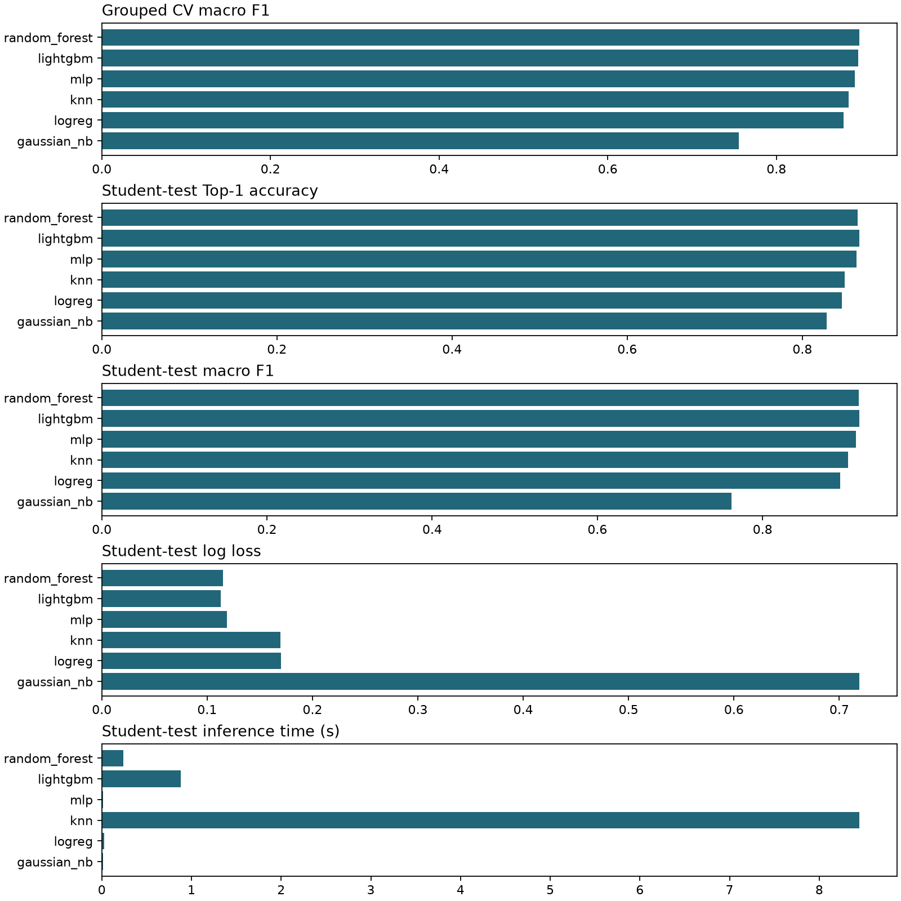

CV macro F1, student-test Top-1 and macro F1, log loss and inference time for all six models (the
inference-time panel in this figure comes from the comparison runs, which used two machines; the table in
3.1 uses one machine).

| | |
|---|---|
| 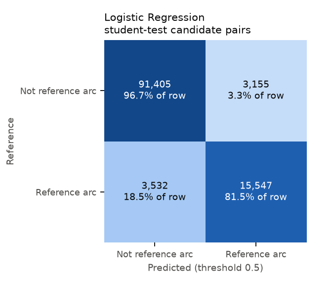 | 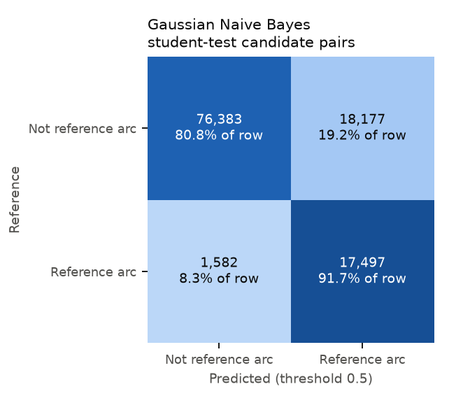 |
| 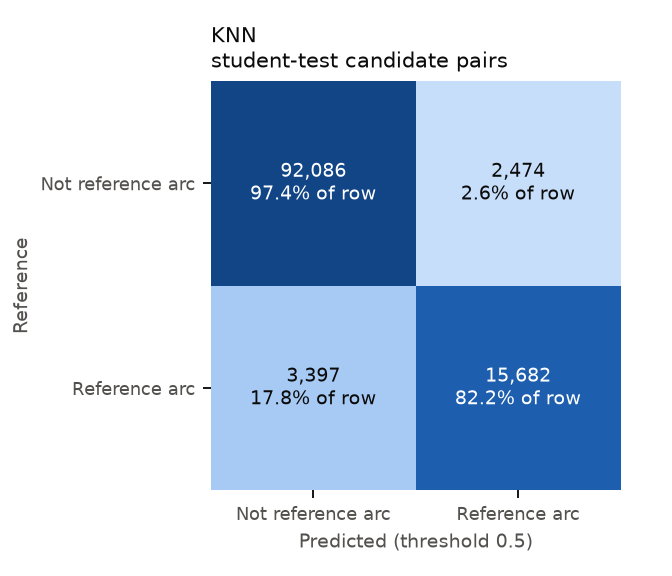 | 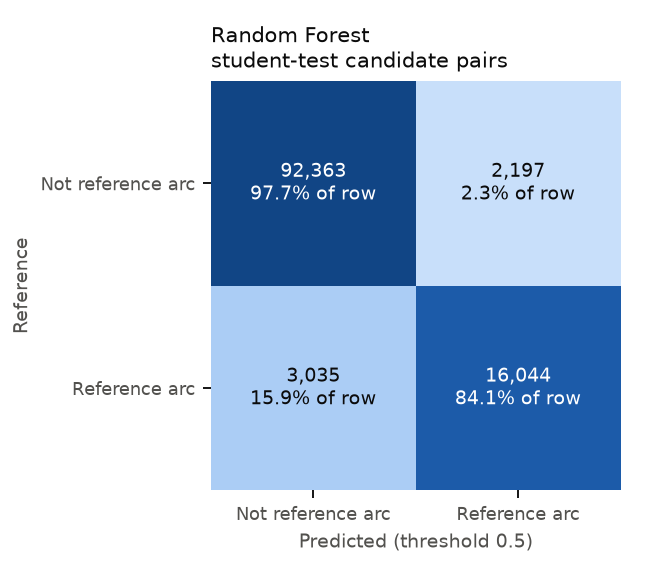 |
|  |  |

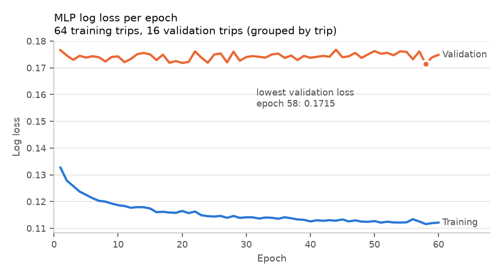

The MLP is the only model with epoch-wise training, so it is the only one with a loss curve. The other
models have no training history and no curve is drawn for them.

## 4. Bayesian hyperparameter optimisation (LightGBM)

### 4.1 Search

1. **Hyperparameters searched:** n_estimators, learning_rate, num_leaves, min_child_samples, subsample,
   colsample_bytree, reg_lambda, reg_alpha.
2. **Ranges** (`configs/search_space.yaml`): n_estimators 100 to 800; learning_rate 0.01 to 0.2 (log);
   num_leaves 15 to 255 (log); min_child_samples 5 to 200 (log); subsample 0.5 to 1.0; colsample_bytree 0.5
   to 1.0; reg_lambda and reg_alpha 0.001 to 10 (log).
3. **Objective:** mean macro F1 over the same 5 GroupKFold-by-trip folds on the 80 training trips.
4. **Trials:** Optuna TPE (seed 42, 8 random start-up trials, three workers sharing one study). Final
   feature set: 32 completed trials (`results/hpo/trials_lightgbm_f15.csv`); trial 0 is the
   untuned configuration. The 12-feature search also ran 32 trials (`results/hpo/trials.csv`).
5. **Best values** (trial 10): n_estimators 657, learning_rate 0.01269, num_leaves 228, min_child_samples 78, subsample 0.8232, colsample_bytree 0.6332, reg_lambda 0.13, reg_alpha 0.002421.
   Each trial took up to 103 s for 5 folds.
6. **Did tuning help?** Not measurably; see 4.3.

### 4.2 Feature ablation

| Untuned LightGBM | CV macro F1 | CV log loss | Student-test macro F1 | Student-test Top-1 | Student-test log loss |
|---|---|---|---|---|---|
| 12 features | 0.8969 | 0.1355 | 0.9172 | 0.8651 | 0.1129 |
| 15 features | 0.8980 | 0.1315 | 0.9178 | 0.8667 | 0.1098 |

### 4.3 Tuned against untuned (15 features)

Same folds and partitions; inference time on one machine (`results/models/inference_time.json`).

| LightGBM, 15 features | CV macro F1 | Student-test Top-1 | Student-test macro F1 | Log loss | Inference time (s) |
|---|---|---|---|---|---|
| Untuned | 0.8980 ± 0.0279 | 0.8667 | 0.9178 | 0.1098 | 0.358 |
| Tuned | 0.9009 ± 0.0261 | 0.8658 | 0.9178 | 0.1100 | 1.983 |

Tuning raised CV macro F1 by 0.0029 and lowered CV log loss from
0.1315 to 0.1286, both well inside the fold-to-fold spread, and left the
student-test scores unchanged, while prediction became about 5.5 times slower (more and deeper trees). The 12-feature search gave the same picture (CV macro F1
0.8969 untuned, 0.9000 tuned; student-test Top-1 0.8651 and
0.8617). We conclude that the defaults were already near the best region. The final model uses
the tuned parameters because the selection rule (the CV objective) was fixed before looking at test results.

## 5. HMM and Viterbi route reconstruction

1. **Hidden states.** At each observation, its candidate arcs (up to 8). Each state keeps its arc id and
   its projected position on that arc, so the decoded state maps straight back to a road segment.
2. **Emission probabilities.** w × log P(candidate is the reference arc), from the classifier, clipped at
   1e-6.
3. **Transition probabilities.** From candidate a at observation i to candidate b at i+1:
   −|network distance − straight-line distance| / β, where the network distance runs along the directed road
   graph from the projected point on a to the projected point on b (Dijkstra, capped at 3 km). A U-turn
   onto the reverse of the same segment costs an extra penalty. Unreachable pairs are −∞.
4. **Missing candidates and large gaps.** Observations without candidates get no prediction and are
   bridged; decoding restarts after time gaps over 60 s.
5. **Disconnected segments.** If every transition between two consecutive observations is −∞, the
   current segment is closed by backtracking and a new segment starts from the next observation's emissions.
6. **Did the HMM improve the route?** Yes, on every metric (tables below).

**Decoder parameters.** Only β × w and the U-turn penalty divided by w affect the best path, so w = 1. β was
searched over 2 to 1000 (`results/hmm/hmm_vs_classifier_wide.json`) and the penalty over 0 to 10, using
out-of-fold probabilities on the training trips only; the rule was the highest training Top-1:

| β = 100, U-turn penalty | Train Top-1 | Train route continuity | Train route arc F1 |
|---|---|---|---|
| 0 | 0.7669 | 0.8530 | 0.8724 |
| 2 | 0.7809 | 0.7966 | 0.8888 |
| 5 | 0.7839 | 0.7825 | 0.8902 |
| 10 | 0.7855 | 0.7803 | 0.8901 |

**Classifier-only against classifier + HMM** (15-feature LightGBM, β = 100, penalty 10;
`results/hmm/hmm_vs_classifier_f15.json`). Route arc F1 compares the set of arcs in the predicted route with
the reference route's arcs, averaged over trips.

| | Train (out-of-fold) classifier | Train + HMM | Student-test classifier | Student-test + HMM |
|---|---|---|---|---|
| Top-1 accuracy | 0.7534 | 0.7855 | 0.8667 | 0.9059 |
| Route continuity | 0.7589 | 0.7803 | 0.7788 | 0.8096 |
| Route arc precision | 0.8130 | 0.8949 | 0.8367 | 0.9102 |
| Route arc recall | 0.8845 | 0.8940 | 0.8872 | 0.8973 |
| Route arc F1 | 0.8390 | 0.8901 | 0.8581 | 0.9019 |

**Where the HMM did not help.** Without the U-turn penalty, the HMM raised student-test route continuity
from 0.7760 to 0.8691
(`results/hmm/hmm_vs_classifier.json`), but about half of its remaining errors were the reverse arc of a
two-way road (5.61% of all student-test points, `results/hmm/error_analysis_wide.json`). In
66.29% of those, the reference arc points against the vehicle's direction of motion,
and 7.42% of all moving student-test points have such a reference arc. We treat
this as a limitation of the reference routes. The U-turn penalty reduces these errors to
3.61% and raises Top-1, but lowers route continuity (training 0.8530 without the
penalty, 0.7803 with it), because following the reference's direction there means consecutive arcs
that do not join. We select on Top-1 and report continuity alongside. A small β × w has the opposite
effect (high continuity, low Top-1), because the decoder then overrides correct short detours.

Leaving trip `00000054` out of training changed student-test HMM Top-1 from
0.9059 to 0.9109, within noise
(`results/hmm/hmm_vs_classifier_f15_excl54.json`); all 80 trips are kept.

## 6. Geographical visualisation (Folium)

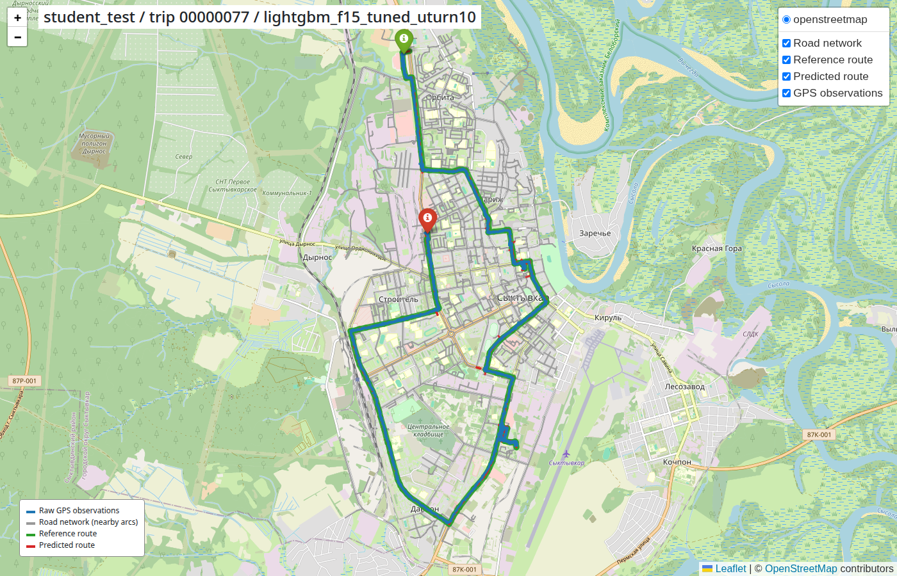

Student-test trip `00000077`, the hardest student-test trip: original GPS observations (blue), road network
near the track (grey), reference route (green) and the final model's predicted route (red), with a legend
and layer control (`results/maps/student_test_00000077_predicted.html`; code in `pathsnap/maps.py` and
`scripts/make_prediction_maps.py`).

## 7. API, UI and deployment

### 7.1 System

- **Laptop 1, API** (`api/main.py`): FastAPI with `GET /trips` (trip ids and point counts) and
  `POST /predict/{trip_id}`. It loads the trip without its route file, runs the exported model
  (`artifacts/lightgbm_f15_tuned_uturn10.joblib`) and the decoder (`pathsnap/predict.py`), then scores the
  prediction against the reference route server side (`api/evaluate.py`). Every request is logged in the
  terminal. Reference routes never leave the server.
- **Laptop 2, UI** (`ui/index.html`): lists the ten trips, sends the selected trip id to the API and shows
  the predicted route on a map with the returned scores.
- Setup and run instructions: README, "Run on two laptops".

### 7.2 End-to-end results (student test)

All 10 student-test trips through the API with the final model
(`results/e2e/api_student_test_lightgbm_f15_tuned_uturn10.json`); all returned HTTP 200.

| Trip | Points | Top-1 | Route continuity | Runtime (s) |
|---|---|---|---|---|
| 00000000 | 2,503 | 0.9561 | 0.8426 | 0.83 |
| 00000007 | 1,354 | 0.9948 | 0.9756 | 0.44 |
| 00000009 | 1,049 | 0.8818 | 0.7950 | 0.53 |
| 00000040 | 2,995 | 0.9332 | 0.8301 | 1.09 |
| 00000052 | 262 | 0.9924 | 0.9036 | 0.16 |
| 00000056 | 3,958 | 0.9325 | 0.8507 | 1.73 |
| 00000065 | 768 | 0.8594 | 0.7881 | 0.42 |
| 00000076 | 1,486 | 0.9145 | 0.7653 | 1.17 |
| 00000077 | 3,911 | 0.8136 | 0.6060 | 1.49 |
| 00000091 | 874 | 0.8902 | 0.7457 | 0.42 |
| **Pooled / mean** | 19,160 | **0.9076** | 0.8103 | |

A fresh clone with a new environment reproduced the earlier end-to-end Top-1 exactly, so results come from
the repository alone.

### 7.3 Evaluator trips

The evaluator trips were received after the final model was committed and were used once, to confirm the
system works on every trip (`scripts/evaluator_smoke_test.py`, `results/e2e/evaluator_smoke_test.json`). The
scorer was replaced by a stub, so no reference route was read and no accuracy was computed. All
10 trips returned a predicted route. Nothing was changed after this check.

### 7.4 Two-laptop run

On 18 November 2026 the API ran on laptop 1 (Fedora, `10.30.202.250:8000`) and the UI on laptop 2
(Windows, `10.30.200.139:8080`), both on the campus Wi-Fi. The UI listed the ten evaluator trips and ran
trip 00000023 end to end, with scoring done on laptop 1. This was after the final model was committed,
and nothing was changed because of it.

The first attempt failed with "Cannot reach the API" even though the requests were reaching laptop 1. The
UI page had been opened from a different address from the one the API allows (CORS). Opening the UI at
laptop 2's network address, the origin set in `PATHSNAP_UI_ORIGIN`, fixed it.

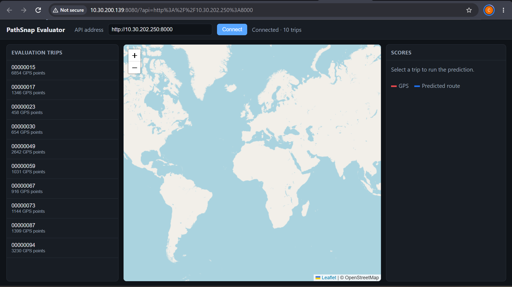

*UI on laptop 2 (address bar: `10.30.200.139:8080`) connected to the API on laptop 1 (`10.30.202.250:8000`),
listing the ten evaluator trips.*

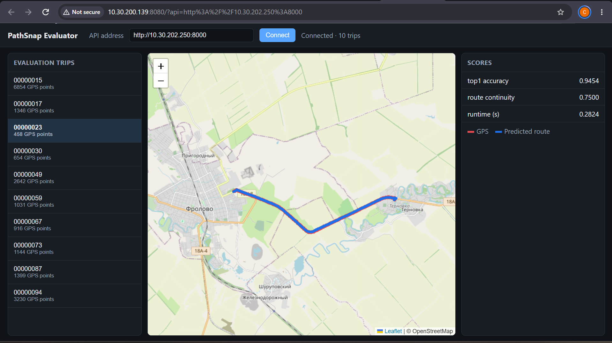

*Trip 00000023: predicted route (blue) over the GPS points (red), with the scores returned by laptop 1.*

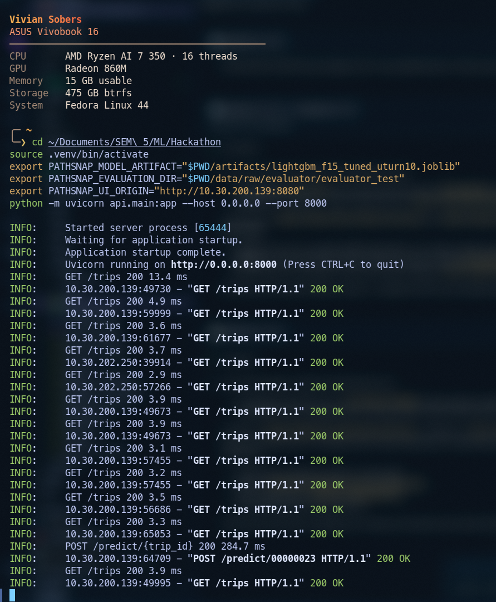

*API terminal on laptop 1. Every request is logged, including `GET /trips` and
`POST /predict/00000023` from laptop 2 (`10.30.200.139`).*

### 7.5 Final scores on the evaluator trips

All 10 evaluator trips through the API with the final model and server-side scoring
(`scripts/api_e2e.py`, `results/e2e/api_evaluator_test_lightgbm_f15_tuned_uturn10.json`, commit
`c96bedb`). This ran once, after the model, decoder settings and report content were final. The same
script reproduces the student-test numbers in section 7.2 exactly. Nothing was changed after this run.

| Trip | Points | Top-1 | Route continuity | Runtime (s) |
|---|---|---|---|---|
| 00000015 | 6,854 | 0.8672 | 0.3688 | 2.26 |
| 00000017 | 1,346 | 0.9264 | 0.6882 | 1.16 |
| 00000023 | 458 | 0.9454 | 0.7500 | 0.22 |
| 00000030 | 654 | 0.8517 | 0.6964 | 0.44 |
| 00000049 | 2,642 | 0.9936 | 0.9450 | 0.97 |
| 00000059 | 1,031 | 0.9641 | 0.7735 | 0.66 |
| 00000067 | 916 | 0.9563 | 0.8481 | 0.35 |
| 00000073 | 1,144 | 0.9781 | 0.9098 | 0.54 |
| 00000087 | 1,399 | 0.9907 | 0.9614 | 1.01 |
| 00000094 | 3,230 | 0.9307 | 0.7387 | 1.25 |
| **Pooled / mean** | 19,674 | **0.9244** | 0.7680 | |

Pooled Top-1 on the evaluator trips (0.9244) is close to the student-test figure
(0.9076), so the model holds up on trips it has never seen. Mean route continuity
is lower (0.7680 against 0.8103), mostly because of
trip 00000015, the longest trip, at 0.3688. We did not
investigate it, so that the evaluator trips stay out of development.

## 8. Conclusions and limitations

- Final pipeline: 50 m / k = 8 candidates, 15 features, tuned LightGBM, HMM/Viterbi with β = 100 and a
  U-turn penalty of 10. Top-1 through the API: 0.9076 on the student-test trips
  and 0.9244 on the evaluator trips.
- The HMM gives the largest gain over the classifier alone. Bayesian optimisation and dropping the noisiest
  training trip gave no measurable gain; we report both as negative results.
- Part of the remaining error lies in the reference routes (arcs pointing against the vehicle's motion),
  which also caps route continuity.
- Training-trip Top-1 is lower than student-test Top-1 mainly because 11.92% of training points have no
  correct candidate, against 0.42% in the student-test trips.
